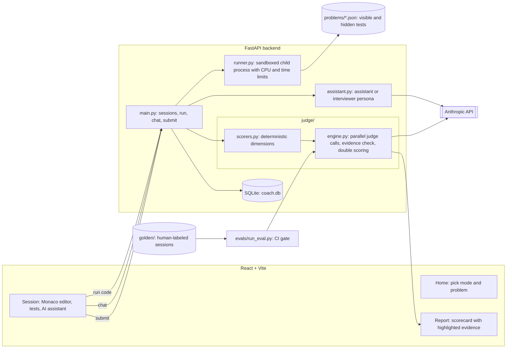

# Interview Coach

[](https://github.com/akshata1710/interview-coach/actions/workflows/ci.yml)
[](https://github.com/akshata1710/interview-coach/actions/workflows/judge-eval.yml)

**Coding-interview practice for the AI era.** You solve a timed problem with an AI assistant beside you. Then an LLM judge scores two things: **how interview-ready your code is** and **how well you worked with the AI**. Every score links to the exact prompts and lines of code it's based on.

Most interview-prep tools only check whether your code passes. Interviews increasingly allow AI tools, so this app also scores the skill those interviews test: framing the problem, breaking it down, checking the AI's output and owning the solution.

**Stack:** FastAPI · Python 3.11+ · Anthropic API (tool-forced structured output) · React 18 + TypeScript + Vite · Monaco editor · SQLite · GitHub Actions

## Highlights

- **LLM-as-judge with guardrails.** Ten rubric dimensions, each with 0/2/4 anchors. Anything measurable (correctness, edge cases, pace, pasted-from-AI code) is scored in code, never by the model. The LLM scores only the judgment calls.
- **Evidence or it didn't happen.** Each LLM score must quote evidence that appears verbatim in the session. A failed quote check triggers one corrective retry, then a hard error.
- **Variance control.** Every dimension is scored twice at temperature 0, and a third run breaks ties when the first two differ by more than 1 point.
- **Judge evals gated in CI.** A golden set of human-labeled sessions is re-scored whenever the judge, rubric or eval code changes. The build fails if agreement drops below the thresholds in [`backend/golden/thresholds.yaml`](backend/golden/thresholds.yaml): at least 80% of scores within ±0.5 of the human score, MAE ≤ 0.75, and no more than a 5-point drop from baseline.
- **Bounded code execution.** Solutions run in a child process with CPU and wall-clock limits. Hidden tests never reach the browser.
- **Works offline.** `COACH_FAKE_LLM=1` runs the full flow with no API key, so CI and the 65 backend tests need no network access.

## Architecture



**Scoring at a glance.** In AI-assisted and interviewer modes, the combined score is 60% coding readiness and 40% prompting quality. Solo mode is 100% readiness.

| Track | Dimension | Weight | Scored by |
| --- | --- | --- | --- |
| Readiness | Correctness | 35% | code |
| Readiness | Complexity | 20% | LLM judge |
| Readiness | Edge cases | 15% | code |
| Readiness | Code quality | 15% | LLM judge |
| Readiness | Independence and pace | 15% | code |
| Prompting | Framing | 20% | LLM judge |
| Prompting | Decomposition | 20% | LLM judge |
| Prompting | Ownership | 25% | LLM judge |
| Prompting | Verification | 20% | LLM judge |
| Prompting | Efficiency | 15% | LLM judge |

Full definitions and anchors are in [`backend/judge/rubric.yaml`](backend/judge/rubric.yaml).

## Run it on a Mac

You need Python 3.11+ and Node 18+ (`python3 --version`, `node --version`). Use two terminal windows.

**Terminal 1: backend (port 8000)**

```bash
cd interview-coach/backend
python3 -m venv .venv
source .venv/bin/activate
pip install -r requirements.txt
echo 'ANTHROPIC_API_KEY=your-sk-ant-api03-key' > .env   # once; .env is git-ignored
uvicorn app.main:app --reload --reload-dir app --reload-dir judge --port 8000
```

**Terminal 2: frontend (port 5173)**

```bash
cd interview-coach/frontend
npm install
npm run dev
```

Open http://localhost:5173.

**No API key yet?** Start the backend with `COACH_FAKE_LLM=1 uvicorn app.main:app --reload --reload-dir app --reload-dir judge --port 8000`. The assistant gives canned replies and scores are placeholders, but the whole flow works.

## Project layout

| Part | What it does |
| --- | --- |
| `frontend/` | React + Vite. Home (pick a mode and problem), session (problem, Monaco editor, tests, assistant), report (scorecard with evidence highlighted in your transcript and code). |
| `backend/app/main.py` | FastAPI: problems, sessions, run, chat, submit, rescore. |
| `backend/app/runner.py` | Runs Python solutions in a child process with CPU and time limits. Hidden test inputs never reach the browser. |
| `backend/app/assistant.py` | The in-session AI: an ordinary assistant, or an interviewer that won't write the solution. |
| `backend/judge/` | The scoring judge: rubric, prompts, evidence checks, double-scoring. |
| `backend/problems/` | Generated by `python tools/build_problems.py`; expected outputs come from reference solutions. |
| `backend/coach.db` | SQLite file holding your sessions. Delete it to start fresh. |
| `backend/evals/` | Measures the judge against human labels: metrics, cached scoring, the CI gate. |
| `backend/golden/` | The golden set: sessions, your labels, thresholds, baseline and the latest report. |

**What gets scored:**
- **Pace:** time to your first all-passing run.
- **Pasted code:** pasting text into the editor that appears in an assistant reply counts as pasted-from-AI code.
- **Your messages:** every message you send is evidence for the prompting score.

## Judge accuracy

The judge is measured against a golden set of human-labeled sessions (`backend/golden/`). Label them on the app's **Label golden set** page, then run `python -m evals.run_eval` in `backend/`. The result goes to `backend/golden/REPORT.md`, and CI fails if agreement drops. See `backend/golden/README.md`.

The golden set has 30 seeded sessions. Agreement numbers will go here once the human labels are in.

## Tests

```bash
cd backend && source .venv/bin/activate && pytest -q   # 65 tests, no API key needed
```

The tests cover the API, the code runner, the judge (with a scripted LLM client), the eval metrics, and a check that every problem's reference solution passes all its tests well inside the time limit. CI runs them on every push, along with a production build of the frontend.

## The problem bank

22 problems: 7 Easy, 13 Medium, 2 Hard, covering hash maps, two pointers, sliding window, binary search, stacks, heaps, graphs (BFS/DFS, topological sort) and dynamic programming. Each one has visible example tests, hidden tests including edge cases, and one large test sized so a brute-force solution hits the 2-second per-test limit.

**To add a problem:**

1. Write a reference solution in `backend/tools/problems_extra.py`.
2. Add a dict to `EXTRA` there. Copy an existing one; tests are built with `case(name, category, hidden, reference_fn, *args)`, so expected outputs come from your reference solution.
3. Pick `compare`: `exact`, `sorted` (list order doesn't matter), `groups` (list of lists, no order anywhere) or a custom checker in `app/runner.py`.
4. Run `python tools/build_problems.py` from `backend/`, then run `pytest -q`. The test fails if the reference solution misses any test or runs too close to the time limit.
5. Restart the backend so it loads the new problem.

Problems that need linked lists or trees aren't supported yet: inputs and outputs are plain JSON values.

## Settings (environment variables)

| Variable | Default | Effect |
| --- | --- | --- |
| `ANTHROPIC_API_KEY` | none | Needed for the assistant and scoring. |
| `COACH_FAKE_LLM` | off | `1` = offline mode. |
| `COACH_ASSISTANT_MODEL` | `claude-sonnet-5-5` | Model for the in-session assistant. |
| `COACH_JUDGE_MODEL` | `claude-sonnet-5-5` | Model for scoring. |
| `COACH_DB` | `backend/coach.db` | Where sessions are stored. |

## Limits of this local version

- **Not a sandbox:** the code runner is a separate process with limits, not real isolation. Only run your own code with it. The Docker runner from the design doc is the next step before anyone else uses it.
- **Python only.**
- **No accounts:** one local user, so every session in `coach.db` is yours.
